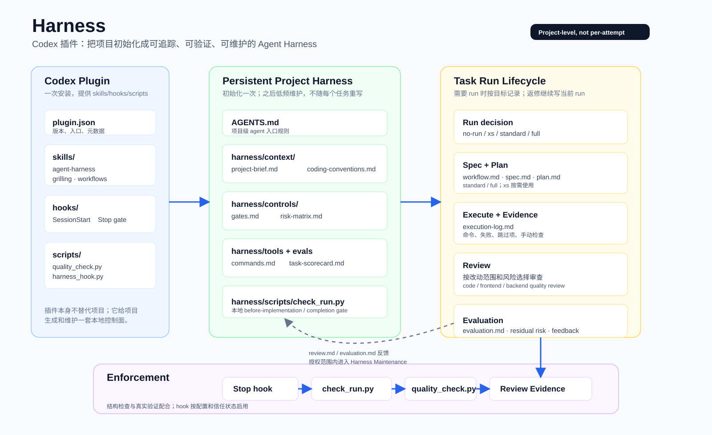

# Harness

Harness 是一个 Codex 插件，帮助项目整理 Agent 所需的上下文、命令和规则，并按任务风险记录计划、验证和 review。



## 安装

```bash
codex plugin marketplace add wcxcw/harness-skills --ref main
codex plugin add harness@harness
```

也可以在 Codex 的插件市场中添加 `wcxcw/harness-skills`，选择 `main` 分支，然后安装 **Harness**。

安装后，按 Codex 提示审阅并信任 hooks。新会话中可检查 SessionStart 提醒和 Skill 是否可见；如果 Stop hook 不可用，完成本地检查后需按工作流显式关闭 run。

## 快速使用

在目标项目的 Codex 输入框中输入 `@Harness`，选择插件后说明任务：

| 场景 | 输入示例 |
| --- | --- |
| 初始化项目 | `@Harness 为这个项目初始化 Harness，保留已有文档和规则。` |
| 更新已有 Harness | `@Harness 检查并更新项目的 Harness，保留项目定制和历史 run。` |
| 开发和修复 | `@Harness 修复移动端导航栏错位的问题，并验证修改。` |

也可以直接选择 **Manage Project Harness**，用于初始化、维护和组织项目级任务。需求或关键决策不清楚时，可显式选择 **Grilling** 或调用 `$grilling`；它通过对话帮助澄清，不创建 run 或文件。

## 项目中会生成什么

默认的 `core` 脚手架会生成以下文件；已有文件默认保留：

```text
AGENTS.md
harness/
├── context/       # 项目简介、代码约定
├── controls/      # 门槛、风险分级
├── tools/         # 项目命令
├── guardrails/    # 工作边界
├── evals/         # 任务评分表
├── scripts/       # check_run.py
└── runs/          # 任务记录
```

初始化前会检查已有项目内容。对于用途不明的非空 `harness/` 目录，应先确认其用途，只有明确要在其中建立本插件的 Harness 时才使用 `--adopt-existing`。

## 任务怎么运行

请求明确、改动局部、不改变行为、不需要决策，且能用一次检查验证并局部回滚的微小改动，可以直接完成。其他任务按风险选择最小的 run 等级：

| 等级 | 适用情况 | 主要记录 |
| --- | --- | --- |
| `xs` | 需要留记录的小改动 | `execution-log.md`、`evaluation.md` |
| `standard` | 一般功能、bugfix 或多文件改动 | XS 记录，加 `workflow.md`、`spec.md`、`plan.md` |
| `full` | 新产品方向或架构、数据、安全等高风险改动 | Standard 记录，加 `input.md`、`review.md` |

支持会话绑定时，run 还包含 `run-state.json`。同一目标的返修和补验证继续记录在原 run 中；已关闭的 run 可以明确恢复，并补充本轮验证。

完整流程通常是：明确需求和决策 → spec → plan → 实现前检查 → 实现 → review → 验证与评估 → 反馈。`xs` 不要求 spec、plan 和 review；具体要求以项目的 `harness/controls/gates.md` 为准。

## 检查与反馈

项目中的 `harness/scripts/check_run.py` 检查 run 文件、必要章节和最低限度的证据记录。**检查通过不代表测试或验收一定通过**，仍需根据实际结果判断。代码质量检查中的大组件、日志等启发式结果仅供参考。

支持会话绑定时，创建或恢复 run 后应在修改前设置 `active`，以记录 Git 基线。基线之后提交的改动和工作区变更会纳入质量检查，但检查器不能判断改动属于谁；旧 run、非 Git 项目或基线不可用时，需要留意检查范围提示。

Stop hook 只复查当前会话中标记为 `verifying` 的 run。首次拦截后会再次检查；如果仍失败，会提示问题并保留 `verifying` 状态。

任务中发现的过时命令、缺失上下文或规则问题可以记录在 `evaluation.md` 的 Harness Feedback 中，按项目规则和用户授权处理。

## 更新已有项目

安装新插件不会自动覆盖项目里的 `AGENTS.md`、`harness/` 或本地检查器。可以让 Codex 先对照新版检查，保留项目定制后按需更新。

若要手动更新检查器，在**本仓库源码目录**运行：

```bash
python3 plugins/harness-skills/skills/agent-harness/scripts/init_harness.py \
  --project /path/to/project \
  --update-checker
```

此命令会覆盖目标项目的 `harness/scripts/check_run.py`。如果它有项目专属修改，应先比较并合并；其他项目文件不会被该选项覆盖。旧 run 的记录可能需要补充证据才能通过新版检查。

## 开发

在本仓库源码目录，可以直接运行初始化和只读项目发现脚本：

```bash
python3 plugins/harness-skills/skills/agent-harness/scripts/init_harness.py --project /path/to/project --language zh-CN
python3 plugins/harness-skills/skills/agent-harness/scripts/discover_project.py --project /path/to/project
```

发现结果只表示项目声明了相关文件或命令，不代表命令已经验证或适合直接执行。

运行插件测试：

```bash
python3 -m unittest discover -s tests -v
```

更多内容见 [Harness Engineering 介绍](docs/Harness%20Engineering.zh-CN.md)和 [workflow skills](plugins/harness-skills/skills/workflows/SKILL.md)。
